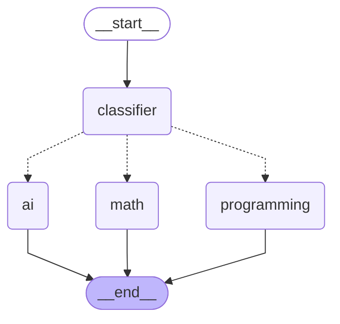
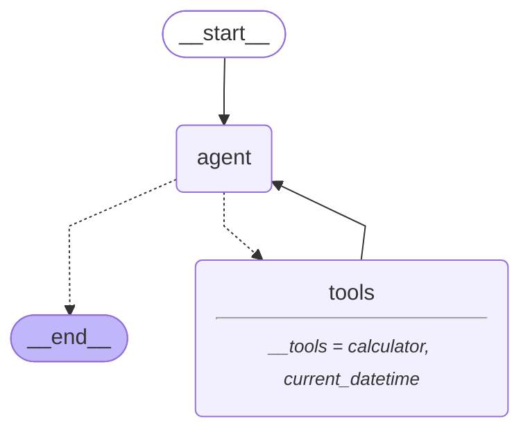
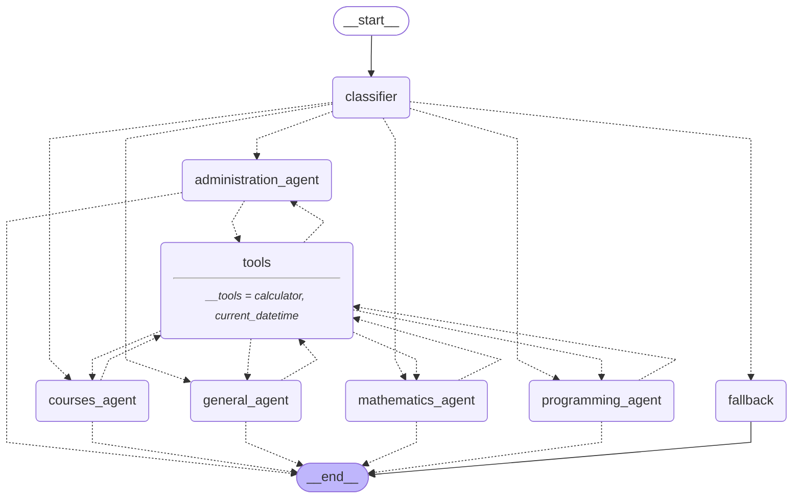

# Architecture diagrams

Exported from the notebook with `graph.get_graph().draw_mermaid()`.

## Router (Parts V-VI)

## Tool-using agent (Part VIII)

## Capstone: Intelligent University Assistant (Part X)

